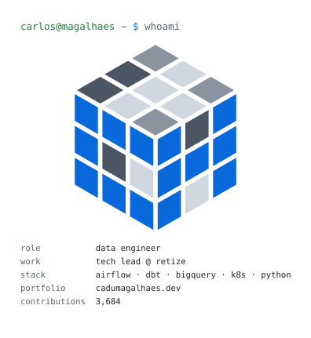

  <picture>
    <source media="(prefers-color-scheme: dark)" srcset="profile-card-dark.svg">
    <source media="(prefers-color-scheme: light)" srcset="profile-card-light.svg">
    
  </picture>

## Projects

**[kuno](https://github.com/1cadumagalhaes/kuno)** — a terminal UI for Kubernetes. Find resources, tail logs, read manifests and describe output, and check events. Keyboard-driven.

**[airsql](https://github.com/1cadumagalhaes/airsql)** — decorator-based SQL execution for Apache Airflow. A DAG task is a Python function, with the SQL inside it.

## Consulting

Independent consulting across data engineering, applications and internal tools, analytics and measurement, cloud and optimization, and ML/MLOps. I also offer workshops and team training.

[Discuss a project on LinkedIn](https://linkedin.com/in/1cadumagalhaes).

## Teaching

I teach data engineering at Alura.

## Writing

I write at [blog.cadumagalhaes.dev](https://blog.cadumagalhaes.dev) — whatever has my attention at the time, usually something technical.

## Elsewhere

[Portfolio](https://cadumagalhaes.dev) · [LinkedIn](https://linkedin.com/in/1cadumagalhaes)
